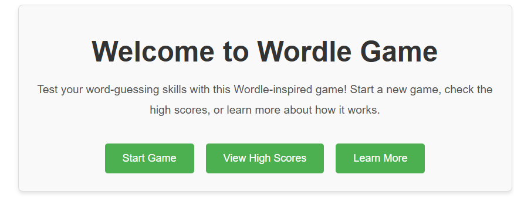
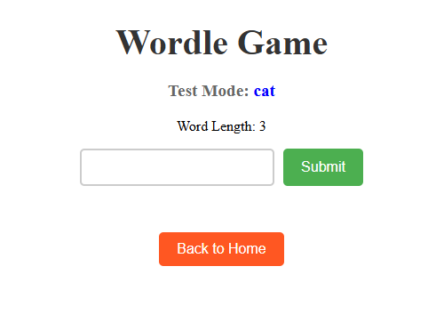

# WordleWow - Wordle Game

Welcome to **WordleWow**, a fun word-guessing game! This guide will help you set up and play the game on your local machine.

## 🚀 Installation & Setup

### 1️⃣ Clone the Repository

Then ...

## ⚙️ Backend Setup
1. Navigate to the backend directory:
   ------
   #  cd WordleWow 
  ------
2. Install dependencies:
   
   npm install 
   
3. Start the backend server:
 
   npm start  OR  node server.js
   
   The backend should now be running on `http://localhost:5080`.

## 🎨 Frontend Setup

1. Go to the frontend directory:
   from WordleWow  file...

   # cd frontend 
   
2. Install dependencies:
   
   npm install  
   
3. Start the frontend application:
 
   npm start
   
   The frontend should now be running on `http://localhost:3000`.

## 🎮 How to Play
1. Open your browser and go to `http://localhost:3000`.
2. Guess the word within six attempts.
3. After each guess:
   - 🟩 **Green**: Correct letter in the correct position.
   - 🟨 **Yellow**: Correct letter in the wrong position.
   - 🟥 **RED**: Letter is not in the word.
4. Keep guessing until you find the correct word or run out of attempts (6)!

## ❓ Troubleshooting
- **Backend not starting?** Ensure Node.js is installed and run `npm install`.
- **Frontend not loading?** Make sure the backend is running and restart the frontend (`npm start`).

  `http://localhost:3000`
 `http://localhost:3000/game`